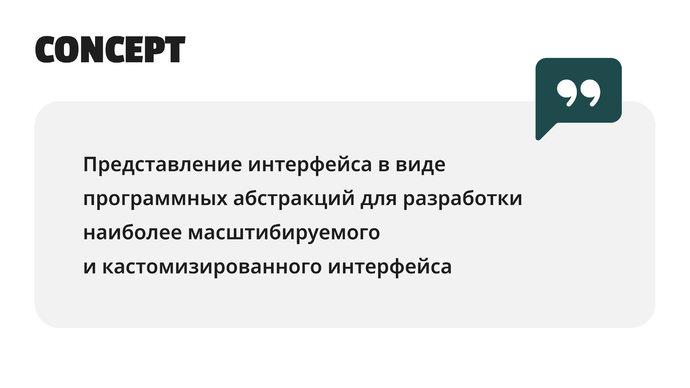
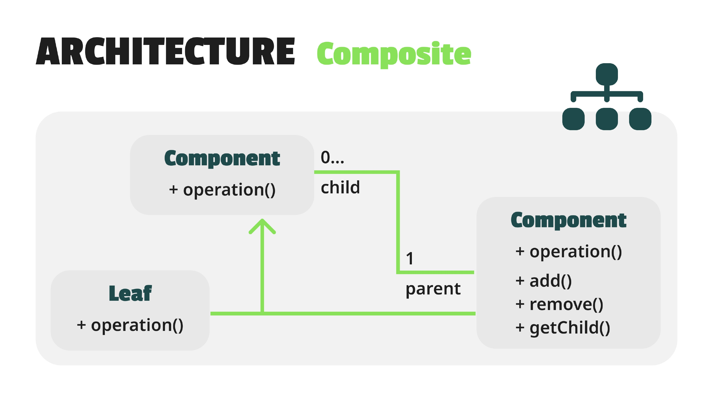
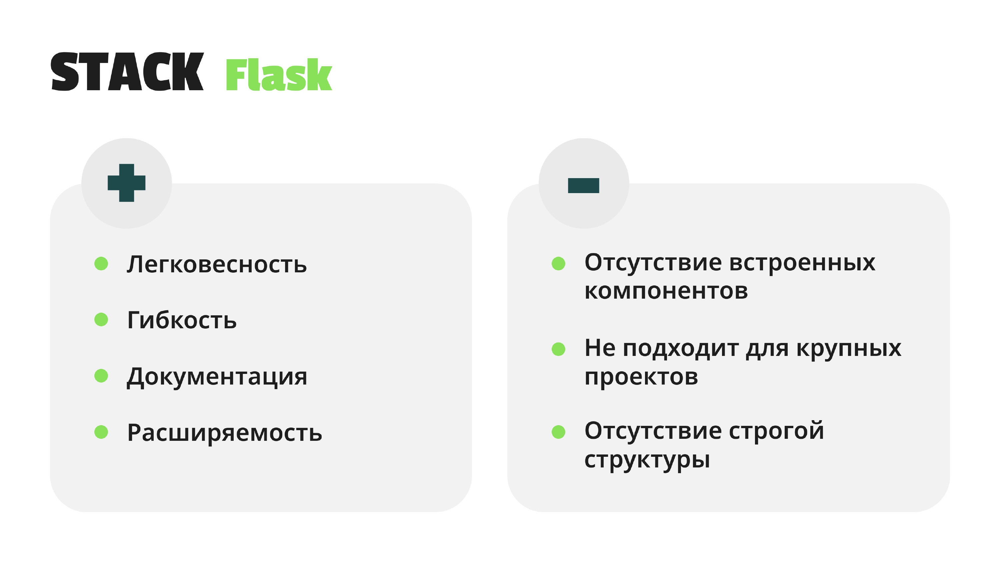
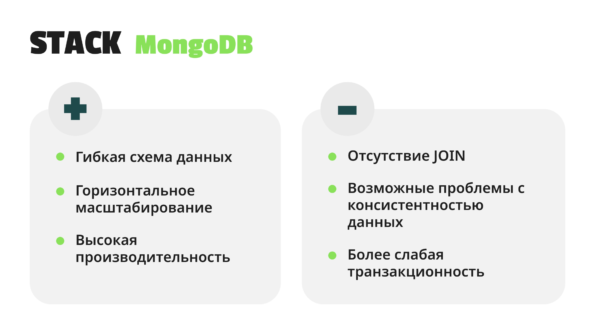
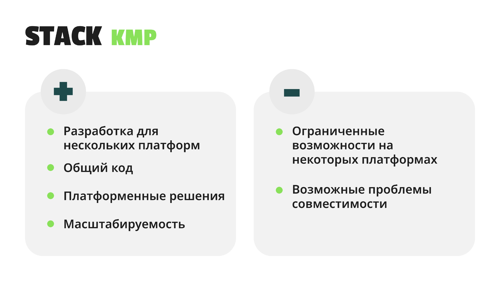
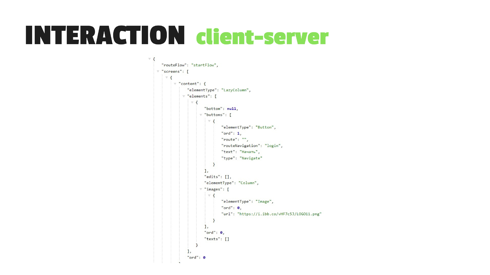

# Хакатон ПРОСТО х СБЕР

В рамках данного хакатона была разработана серверная часть, которая 
задает UI элементы, которые необходимо отрисовать клиентской. Концепт взят из единой фронтальной системы крупных компаний. Реализовано посредством шаблона 
проектирования компоновщик.
---
[Сертификат участника](other/sberCertificate.jpg) \
[Полная презентация продукта](other/ProstoxsberPresentation.pdf)
---
### Технологический стек:
* Python
* Flask 
* MongoDB
---

  

  

  

  

  

  

---